# Awesome 3D Generative Code & WebGL Shaders ✨

  

  <strong>Curated Directory of Top SaaS Platforms &amp; Open-Source Projects for 3D Generative Code, GLSL/WGSL Shaders, Procedural SDF Worlds, and Spatial AI Agents 🚀</strong>

---

## 📖 Table of Contents 📑

- [🌟 Ecosystem Overview](#-ecosystem-overview)
- [📊 Sector Overview & Market Dynamics](#-sector-overview--market-dynamics)
- [🏢 SaaS & Hosted Platforms](#-saas--hosted-platforms)
- [💻 Open-Source GitHub Projects](#-open-source-github-projects)
- [🤝 How to Contribute](#-how-to-contribute)
- [💖 Support & Sponsorship](#-support--sponsorship)
- [📈 Star History](#-star-history)
- [⚠️ Disclaimer](#️-disclaimer)

---

## 🌟 Ecosystem Overview 🌐

This repository curates notable **SaaS platforms** ☁️ and **open-source repositories** 🛠️ powering **3D Generative Code & WebGL/WebGPU Shaders**. These tools empower creative coders 🎨, graphics engineers 💻, demoscene artists 🕹️, and spatial AI coding agents 🤖 to synthesize real-time GLSL/WGSL shaders, compose node-based procedural materials, live-code algorithmic 3D scenes, and verify spatial code execution deterministically.

* **GLSL & WGSL Focus:** Real-time fragment shaders, vertex point clouds, raymarching signed distance fields (SDFs), and compute-driven particle simulations.
* **Spatial 3D-as-Code & AI Agents:** Verification harnesses, multi-agent evaluation frameworks, and program-synthesis pipelines (Blender, CadQuery, Three.js, OpenSCAD).
* **Creative Coding & Live-Coding:** In-browser IDEs, audio-reactive VJ synthesizers, and modular pragma-linked shader libraries.

---

## 📊 Sector Overview & Market Dynamics 📈

The global market for 3D rendering, procedural visualization, and generative graphics software is estimated at **$4.8B – $5.4B** (scaling toward **$17B+** at an **18%–25% CAGR**), propelled by the convergence of WebGPU adoption, browser-based creative tooling, and AI-driven code synthesis. The sector exhibits a **bimodal structure**: it is **moderately fragmented** at the developer tooling, sandbox, and indie SaaS layer with dozens of innovative specialized platforms, yet anchored upstream to a **concentrated foundational core** governed by browser engine vendors (Chromium, WebKit), hardware GPU standards (Khronos Group, W3C), and parent tech conglomerates (such as Snap Inc. and Autodesk).

---

## 🏢 SaaS & Hosted Platforms ☁️

The following table presents premier SaaS and hosted platforms for 3D generative code, WebGL shaders, and spatial interactive sketching. Products are sorted in **descending order by company size** (market capitalization / enterprise valuation or annual revenue run-rate).

| Company / Product 🏢 | Market Size / Valuation 💰 | Starting Tier Pricing 🏷️ | Free Tier Limits 🎁 | Core Capabilities 🎯 |
| :--- | :--- | :--- | :--- | :--- |
| **[PlayCanvas](https://playcanvas.com)** | **Subsidiary of Snap Inc.** (~$18B+ Market Cap) | **$15/month** (Personal Plan billed monthly; $50/user/mo for Org) | **Free forever with strictly public projects**: 1 GB cloud asset storage, unlimited public projects, and community support; unlisted/private hosting, custom preloading screens, and code self-hosting require Personal tier. | Cloud-hosted collaborative WebGL/WebGPU 3D engine and game editor with visual scene hierarchy, physics, and custom GLSL/WGSL shaders. |
| **[Spline](https://spline.design)** | **~$50M - $100M valuation** ($25M+ raised, ~$5M ARR) | **$12/month** (Hobby Plan billed annually at $144/yr; $15/mo billed monthly) | **Free forever with Spline watermark**: Limited personal files, 3 public files, access to standard 3D asset libraries; exports include Spline branding watermark, and advanced variables/APIs and watermark removal require Hobby/Pro. | Collaborative browser-based 3D modeling and animation platform with interactive WebGL export, real-time physics, and custom material shaders. |
| **[CodePen](https://codepen.io)** | **~$15M - $25M valuation** (~$1M funding, ~$1M+ ARR) | **$8/month** (Starter Plan billed annually at $96/yr; $12/mo billed monthly) | **Free forever with public-only Pens**: Unlimited public Pens, 3 files per Pen (1 HTML, 1 CSS, 1 JS), 0 MB asset hosting (external CDN links required); private Pens, asset storage, and multi-user Collab Mode require Pro. | Leading web front-end playground and community hub widely utilized for live WebGL, Three.js, and GLSL generative shader sketches. |
| **[ShaderFrog](https://shaderfrog.com)** | **Bootstrapped Indie SaaS** (<$1M valuation) | **$33 one-time lifetime payment** (Pre-launch Pro Lifetime tier) | **Free forever for community shaders**: Unlimited public WebGL shader editing, browser-based visual graph composition, and standard GLSL Three.js code export; AI MCP server integrations and premium preset libraries require Pro. | Hybrid visual node-based and raw code WebGL shader composer enabling artists to blend multiple GLSL shaders together with live Three.js exports. |
| **[ISF Editor](https://isf.video)** | **Specialized Open Protocol / Platform** (<$1M valuation) | **Free / Open Hosted Tool** (Supported by VIDVOX commercial licenses from $99) | **Free forever without seat limits**: Full browser authoring of Interactive Shader Format shaders, live parameters, and shader downloads; commercial production tools like VDMX desktop licenses start at $99. | Web-based shader authoring platform and standard for real-time visual FX and generators compatible with VJ suites (VDMX, Resolume, MadMapper). |
| **[Shadertoy](https://shadertoy.com)** | **Community Platform** (Patreon supported, <$1M valuation) | **$2/month** (Patreon Community Supporter Tier) | **Free forever with public publishing**: Unlimited public multi-pass fragment shader creation, audio-reactive inputs, multipass framebuffers, and VR rendering; private shader limits and creator badges tied to Patreon tiers. | The premier cloud community and live browser sandbox for writing, sharing, and remixing WebGL fragment shaders, raymarched 3D scenes, and audio synthesis. |
| **[Compute.toys](https://compute.toys)** | **Open Community Platform** (<$500K valuation) | **Free / Community Supported** ($0/month open platform) | **Free forever with community limits**: Full access to write, compile, run, and publish WebGPU compute shaders (WGSL), atomic float operations, and frame ping-ponging across supported WebGPU browsers. | Cloud WebGPU compute shader sandbox and gallery dedicated to authoring, benchmarking, and sharing WGSL compute-driven particle systems and raytracers. |
| **[The Book of Shaders](https://thebookofshaders.com)** | **Educational Platform** (Sponsorship supported, <$500K valuation) | **Free Educational Resource** (Optional community sponsorship) | **Free forever with unrestricted access**: Full access to all interactive step-by-step chapters, embedded live GLSL canvas editors, procedural noise lessons, and downloadable source snippets. | Interactive web guide and embedded GLSL playground teaching step-by-step algorithmic drawing, cellular automata, fractal brownian motion, and raymarching. |
| **[Shader Park](https://shaderpark.com)** | **Open-Access Web Platform** (<$500K valuation) | **Free / Open Access** ($0/month community tool) | **Free forever without feature paywalls**: Browser live-coding of JS/GLSL distance field shaders, real-time 3D viewport rendering, and export to Three.js / TouchDesigner components. | JavaScript-to-GLSL signed distance field (SDF) live-coding environment enabling creators to code interactive volumetric 3D sculptures. |
| **[GLSL Sandbox](https://glslsandbox.com)** | **Classic Community Gallery** (<$250K valuation) | **Free / Community Archive** ($0/month open tool) | **Free forever with public gallery access**: Unmetered browser-based GLSL fragment shader editing, instant URL-based permalinks, and real-time community gallery fork viewing. | Pioneer real-time GLSL fragment shader live code editor and community archive built for lightweight visual experimentation and procedural art sharing. |
| **[VertexShaderArt](https://vertexshaderart.com)** | **Niche Creator Platform** (<$250K valuation) | **Free / Indie Hosted** ($0/month community tool) | **Free forever with public gallery access**: Unmetered procedural vertex shader authoring, audio spectrum music reactivity, point-cloud transformations, and custom sound stream binding. | Cloud live-coding playground and gallery focused on procedural WebGL vertex shaders, audio-reactive point clouds, and line/triangle primitive morphing. |

---

## 💻 Open-Source GitHub Projects 🛠️

The following repositories represent foundational tools, libraries, shader IDEs, and spatial AI harnesses for 3D generative code and WebGL/WebGPU graphics. Repositories are sorted in **descending order by GitHub star count** ⭐.

| Repository 📦 | GitHub Stars ⭐ | License 📜 | Description & Focus 📝 |
| :--- | :--- | :--- | :--- |
| **[mrdoob/three.js](https://github.com/mrdoob/three.js)** |  | `MIT` | The premier JavaScript 3D library for WebGL/WebGPU, featuring custom `ShaderMaterial`, post-processing passes, TSL (Three.js Shading Language), and browser scene editor. |
| **[pmndrs/react-three-fiber](https://github.com/pmndrs/react-three-fiber)** |  | `MIT` | Powerful React renderer for Three.js, enabling declarative, component-driven 3D generative scenes, custom shader hook bindings, and dynamic canvas rendering. |
| **[BabylonJS/Babylon.js](https://github.com/BabylonJS/Babylon.js)** |  | `Apache-2.0` | Comprehensive WebGL/WebGPU 3D graphics engine offering a drag-and-drop Sandbox, Node Material Editor (NME), and native GLSL/WGSL custom shader pipelines. |
| **[gfx-rs/wgpu](https://github.com/gfx-rs/wgpu)** |  | `MIT` / `Apache-2.0` | Safe, cross-platform Rust implementation of the WebGPU specification for high-performance native and browser-targeted compute & graphics shader pipelines. |
| **[playcanvas/engine](https://github.com/playcanvas/engine)** |  | `MIT` | Fast and lightweight WebGL/WebGPU 3D game and graphics engine built for high-performance interactive web experiences, physically-based materials, and custom shaders. |
| **[pmndrs/drei](https://github.com/pmndrs/drei)** |  | `MIT` | Growing collection of useful helpers, procedural shader materials (MeshReflectorMaterial, MeshWobbleMaterial), and camera abstractions for React Three Fiber. |
| **[shader-slang/slang](https://github.com/shader-slang/slang)** |  | `Apache-2.0` | Next-generation shading language and multi-target compiler supporting modularity, generics, and automatic differentiation targeting SPIR-V, WGSL, GLSL, and HLSL. |
| **[regl-project/regl](https://github.com/regl-project/regl)** |  | `MIT` | Fast, functional WebGL abstraction layer that treats WebGL state as a pure function, drastically simplifying procedural buffer rendering and shader pipelines. |
| **[jagenjo/webglstudio.js](https://github.com/jagenjo/webglstudio.js)** |  | `MIT` | Full browser-based open-source 3D graphics studio and scene editor featuring node-based visual shader graphs, animation timelines, and custom GLSL code injection. |
| **[dfranx/SHADERed](https://github.com/dfranx/SHADERed)** |  | `MIT` | Lightweight, feature-packed desktop and web shader IDE supporting HLSL/GLSL, compute shaders, geometry stages, render textures, and pixel-level debugging. |
| **[oframe/ogl](https://github.com/oframe/ogl)** |  | `MIT` | Minimal, high-performance WebGL library designed for creative technologists who want complete control over buffers and custom vertex/fragment shaders. |
| **[patriciogonzalezvivo/lygia](https://github.com/patriciogonzalezvivo/lygia)** |  | `MIT` | Granular multi-language shader library providing hundreds of reusable, dependency-free functions for GLSL, HLSL, WGSL, MSL, and CUDA (noise, SDF, raymarching, lighting). |
| **[greggman/twgl.js](https://github.com/greggman/twgl.js)** |  | `MIT` | Tiny WebGL helper library that eliminates the verbosity of raw WebGL boilerplate, making shader compilation, uniform setting, and buffer binding concise. |
| **[hydra-synth/hydra](https://github.com/hydra-synth/hydra)** |  | `AGPL-3.0` | Browser-based live-coding video synthesizer inspired by analog modular synthesizers; compiles chained JavaScript functional pipelines into real-time WebGL shaders. |
| **[patriciogonzalezvivo/glslEditor](https://github.com/patriciogonzalezvivo/glslEditor)** |  | `MIT` | Embeddable web GLSL fragment shader editor created for *The Book of Shaders*, featuring inline error markers, color pickers, and live uniform sliders. |
| **[patriciogonzalezvivo/glslCanvas](https://github.com/patriciogonzalezvivo/glslCanvas)** |  | `MIT` | Lightweight JavaScript library that renders GLSL fragment shaders directly onto HTML5 `<canvas>` tags with zero boilerplate and automatic uniform injection. |
| **[glslify/glslify](https://github.com/glslify/glslify)** |  | `MIT` | Node.js-style module system for GLSL; enables modular `#pragma glslify: import` statements to compose reusable shader algorithms across packages. |
| **[Gargaj/Bonzomatic](https://github.com/Gargaj/Bonzomatic)** |  | `Unlicense` | Iconic live-coding GLSL/HLSL shader showdown tool used across the international demoscene, featuring zero-latency compilation and real-time FFT audio textures. |
| **[FarazzShaikh/THREE-CustomShaderMaterial](https://github.com/FarazzShaikh/THREE-CustomShaderMaterial)** |  | `MIT` | Extend Three.js standard, physical, and PBR materials with custom vertex and fragment shaders without re-implementing lighting, shadows, or environment maps. |
| **[stevensona/shader-toy](https://github.com/stevensona/shader-toy)** |  | `MIT` | Highly popular VS Code extension enabling real-time local Shadertoy-compatible GLSL shader previews, uniform sliders, and glslify integration. |
| **[gaoypeng/3dcodeverse](https://github.com/gaoypeng/3dcodeverse)** |  | `Apache-2.0` | Groundbreaking multi-agent DAG harness, benchmarking stack, and [3DCodeVerse-2M Corpus](https://huggingface.co/datasets/3dcodeverse/3dcodeverse-2m) enabling AI agents to generate, verify, and repair 3D code across GLSL, Three.js, Blender, CadQuery, and OpenSCAD. |
| **[zeokku/glsl.app](https://github.com/zeokku/glsl.app)** |  | `AGPL-3.0` | Modern web-based WebGL GLSL shader editor built on Monaco Editor and ShaderFrog AST parser, featuring IntelliSense, `#include` composability, and live uniform controls. |
| **[racz16/WebGL-GLSL-Editor](https://github.com/racz16/WebGL-GLSL-Editor)** |  | `MIT` | VS Code extension providing offline live WebGL GLSL shader previews, multi-texture uniform inputs, diagnostic tooltips, and rendering loop controls. |
| **[Tezumie/ShaderMate](https://github.com/Tezumie/ShaderMate)** |  | `MIT` | Zero-dependency, lightweight JavaScript library for embedding multi-pass, Shadertoy-compatible GLSL shaders onto any HTML5 canvas or React component. |
| **[benc-uk/webgl-sandbox](https://github.com/benc-uk/webgl-sandbox)** |  | `MIT` | Interactive WebGL2 GLSL shader sandbox powered by Monaco Editor with multi-pass post-processing, microphone audio reactivity, MIDI controller inputs, and MP4 capture. |
| **[gaoypeng/3dcode_toolkit](https://github.com/gaoypeng/3dcode_toolkit)** |  | `Apache-2.0` | Open-source CLI (`3dcode`) for geometrically validating, perceptual deduplicating, rendering, and curating executable 3D code assets across Blender, CadQuery, and FreeCAD. |

---

## 🤝 How to Contribute ✍️

We warmly welcome community contributions! Follow these steps to submit additions or improvements:

1. 🍴 **Fork the repository** to your personal GitHub account.
2. 🌿 **Create a descriptive feature branch** (`git checkout -b feat/add-new-shader-tool`).
3. 📝 **Add or update entries in `README.md`**:
   * For SaaS products, include pricing tiers, free plan limits, company size/valuation, and feature breakdown.
   * For Open-Source projects, provide repo link, star badge (`style=social&color=white`), license, and focus.
4. 🚀 **Commit your changes cleanly** and open a Pull Request with a short summary of the additions.

---

## 💖 Support & Sponsorship ☕

If this curated 3D generative code and WebGL shader directory helps your creative coding journey, spatial computing research, or AI agent development, please consider supporting the project:

* ⭐ **Star this repository** on GitHub to amplify its reach!
* 🍴 **Fork and share** with colleagues, graphics programmers, and creative coding communities.
* ☕ **Buy a coffee & sponsor ongoing maintenance:** [GitHub Sponsors @ishandutta2007](https://github.com/sponsors/ishandutta2007)

Thank you so much to all our community stargazers, contributors, and sponsors! Your backing fuels continuous updates across the WebGL/WebGPU ecosystem. ✨

---

## 📈 Star History 🌟

---

## ⚠️ Disclaimer 🛡️

* This list is **community-curated** for educational, scientific, and creative development purposes — inclusion does not constitute commercial endorsement.
* Complex raymarched fragment shaders, multi-pass framebuffers, and WebGPU compute passes demand GPU acceleration (`WebGL2` / `WebGPU`); optimize loops and uniforms for cross-platform and mobile performance.
* Verify individual shader licenses (`MIT`, `Apache-2.0`, `CC BY-NC-SA`, `AGPL-3.0`) prior to incorporating code or generative assets into commercial software.

---

**Curated with ❤️ for creative coders, shader wizards, graphics engineers, and spatial AI pioneers worldwide.** 🚀

